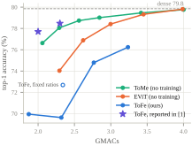

# Reproducing ToFe: Token Freezing and Reusing for Efficient Vision Transformers

Midterm reading project for **CMP684 Neural Networks** (Hacettepe University), by Hasan Berk Karabay.

In this project I re-implemented the method of the paper below from its text (the authors did
not release code) and checked its main claims on DeiT-S with ImageNet-1k.

> H. Zhang, J. Zhang, C. Hu, and S. Guo, "ToFe: Lagged Token Freezing and Reusing for Efficient
> Vision Transformer Inference," *IEEE Transactions on Neural Networks and Learning Systems*,
> vol. 37, no. 10, pp. 5545-5558, Oct. 2026. [DOI](https://doi.org/10.1109/TNNLS.2026.3684383) | [arXiv](https://arxiv.org/abs/2507.16260)

- Report (IEEE two-column format, 6 pages): [report/CMP684_Midterm_Karabay_N25220154.pdf](report/CMP684_Midterm_Karabay_N25220154.pdf)
- Code: [src/](src) (PyTorch; the method itself is in [src/tofe.py](src/tofe.py))
- Results behind every table: [runs/](runs)
- Trained models of all 19 runs (129 MB): [models/](models)

## What ToFe does

ToFe speeds up a vision transformer by using fewer tokens in the later blocks. Unlike pruning or
merging methods, it does not throw tokens away: a small MLP *freezes* unimportant tokens, another
small MLP updates them while they skip some blocks, and they can be *reused* later. A FLOPs loss
decides how many tokens each of the three stages keeps.

## Main results

DeiT-S on the full ImageNet-1k validation set (50,000 images), at about 50% of the FLOPs:

| Method | GMACs | Top-1 (%) |
|---|---:|---:|
| DeiT-S, no reduction | 4.60 | 79.85 (paper: 79.9) |
| ToMe r=16, no training | 2.29 | 78.06 |
| EViT, no training | 2.30 | 74.13 |
| ToFe, my implementation (2 seeds) | 2.32 | 69.66 (paper: 77.7) |
| ToFe without token reusing (2 seeds) | 2.32 | 71.73 |
| ToFe with fixed keep ratios (1/3 each) | 2.34 | 72.68 |



Findings in short:

- The baselines match the paper (DeiT-S 79.85% vs. 79.9%, ToMe 76.6% vs. 76.5% at about 2.0 GMACs).
- Three of the four observations that motivate ToFe hold: early [CLS] attention is spread out,
  important tokens change between blocks, and neighbouring blocks are similar.
- The fourth one does not hold: tokens that look unimportant change by more than their own size
  over three blocks, so the small approximator cannot follow them and reused tokens are wrong.
- With about 59 times less training than the paper, ToFe stayed below the training-free baselines.
  Token reusing, the learned budget and the proposed selector were all worse than the alternatives.

## Repository layout

```
report/   the report (PDF), its source (ieee/paper.html) and figures
src/      all code (PyTorch); tofe.py contains the method
runs/     result files behind every table (JSON, training logs)
models/   trained checkpoints of all runs (see models/README.txt)
```

## How to run

Tested on one NVIDIA RTX 5070 (12 GB) with Python 3.13 and PyTorch 2.11 (CUDA 12.8).

```bash
pip install torch==2.11.0 torchvision==0.26.0 --index-url https://download.pytorch.org/whl/cu128
pip install -r requirements.txt

# ImageNet-1k from the Hugging Face hub (needs an account that accepted the dataset terms)
export HF_TOKEN=<your token>
bash src/download_imagenet.sh validation 0 13 14
bash src/download_imagenet.sh train 0 29 294
python src/prepare_imagenet.py && python src/resize_train.py && python src/cache_val.py

python src/test_tofe.py                      # unit tests
python src/motivation.py                     # motivating observations
python src/eval_baselines.py                 # dense model, EViT, ToMe, random tokens
python src/train_tofe.py --name tofe_b50     # one ToFe model (about 20 minutes)
bash src/run_queue.sh                        # all ablations
python src/analyze_tofe.py tofe_b50          # inference modes, token statistics
python src/diagnostics.py                    # why token reusing fails here
python src/paper_figures.py && python src/build_paper.py   # figures and the report PDF
```

To evaluate a trained model without training it again, only the validation data is needed:
`python src/analyze_tofe.py <run>` loads `models/<run>.pt` by itself. The report PDF is built
with headless Microsoft Edge.

## Notes

- The ImageNet data and the original paper PDF are not included (license and copyright).
- Every number in the report tables is read from the files in `runs/` (`src/paper_tables.py`).
